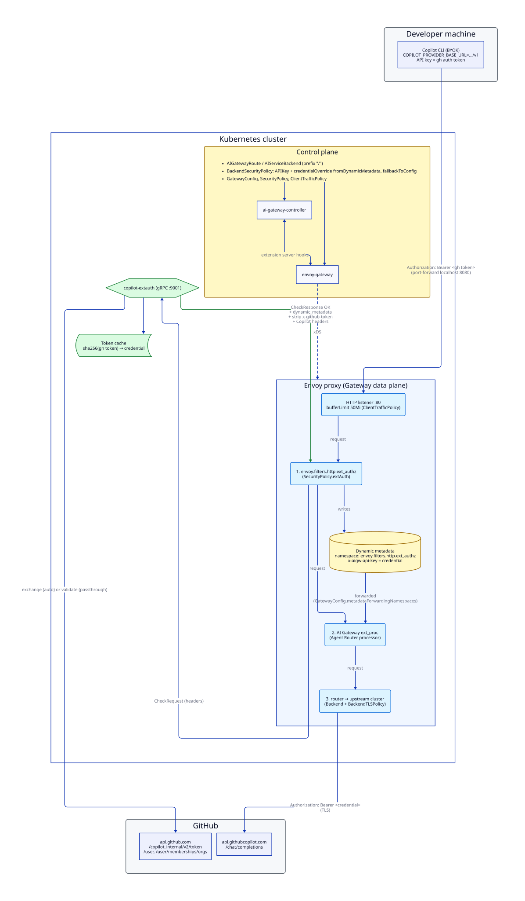

# Architecture

GitHub Copilot is served through Agent Router, and every request is authenticated with the **caller's own GitHub
identity** instead of a shared Copilot credential stored in a Kubernetes Secret.



Source: [`architecture.d2`](architecture.d2).

## Components

| Component                                                              | Role                                                                                                          |
| ---------------------------------------------------------------------- | ------------------------------------------------------------------------------------------------------------- |
| **Client** (Copilot CLI in BYOK mode, or any OpenAI-compatible client) | Sends `Authorization: Bearer <GitHub token>` (or `x-github-token`) to the gateway                             |
| **Envoy proxy** (Gateway data plane)                                   | Runs the HTTP filter chain: `ext_authz` → AI Gateway `ext_proc` → router                                      |
| **copilot-extauth** (this repo)                                        | gRPC `envoy.service.auth.v3.Authorization` server. Turns a GitHub token into the upstream Copilot credential  |
| **Agent Router processor** (`ext_proc`)                                | Translates/routes the request and injects the upstream credential selected by the `BackendSecurityPolicy`     |
| **Envoy Gateway + ai-gateway-controller** (control plane)              | Compile the CRDs into Envoy xDS. The AI controller patches xDS through Envoy Gateway's extension-server hooks |
| **GitHub**                                                             | `api.github.com` validates/exchanges tokens; `api.githubcopilot.com` serves `/chat/completions`               |

## The Envoy hook: `ext_authz`

The service plugs into Envoy through the **external authorization HTTP filter**
([`envoy.filters.http.ext_authz`](https://www.envoyproxy.io/docs/envoy/latest/configuration/http/http_filters/ext_authz_filter)).
It is enabled with an Envoy Gateway `SecurityPolicy`:

```yaml
extAuth:
  failOpen: false
  headersToExtAuth: [authorization, x-github-token]
  grpc:
    backendRefs: [{ name: copilot-extauth, port: 9001 }]
```

For every request, before any routing or AI processing happens, Envoy pauses the request and calls
`Authorization.Check(CheckRequest)` on copilot-extauth. Only the headers listed in `headersToExtAuth` are sent. The body
is not sent. The service answers with a `CheckResponse` that uses three features of the ext_authz protocol:

| `CheckResponse` field                       | Used for                                                                                                                                            |
| ------------------------------------------- | --------------------------------------------------------------------------------------------------------------------------------------------------- |
| `status` + `denied_response`                | 401 when no token is present, 403 when the token is invalid, not in `ALLOWED_ORG`, or has no Copilot access. The request never reaches the upstream |
| `ok_response.headers` / `headers_to_remove` | Adds `Copilot-Integration-Id` and `Editor-Version`, which Copilot requires. Strips `x-github-token`                                                 |
| **`dynamic_metadata`**                      | Returns `{ "x-aigw-api-key": <credential> }`. Envoy stores it under the filter's metadata namespace `envoy.filters.http.ext_authz`                  |

### From ext_authz metadata to the upstream `Authorization` header

Dynamic metadata is per-request state that is internal to Envoy. Filters can read and write it, but clients cannot.
Agent Router reads it in its own filter, which runs next:

1. **`GatewayConfig.spec.extProc.metadataForwardingNamespaces: [envoy.filters.http.ext_authz]`.** The controller
   configures the AI Gateway `ext_proc` filter to forward this untyped metadata namespace to the processor. Envoy
   forwards nothing by default. This requires Agent Router **v1.2.0 or later**: in v1.1.0 the metadata was never
   forwarded.
2. **`BackendSecurityPolicy.spec.credentialOverride.fromDynamicMetadata`** (`namespace: envoy.filters.http.ext_authz`,
   `key: x-aigw-api-key`). When the processor picks the Copilot backend, it reads the credential from that key instead
   of from the static Secret. It then writes it as `Authorization: Bearer <credential>`, overwriting whatever the
   client sent.
3. **`fallbackToConfigured: false`.** If the metadata is missing, the processor returns 401 rather than using the
   placeholder Secret. The shared credential can never be used by accident.

Using metadata rather than a request header is deliberate. A client cannot forge it. It never appears in access logs.
It also cannot leak to a different backend on retries or fallback.

## Request flow

1. The client sends `POST /v1/chat/completions` with its GitHub token. Locally this goes through
   `kubectl port-forward` to `localhost:8080`.
2. The listener buffers up to 50 MiB, set by a `ClientTrafficPolicy`. Agent prompts are larger than Envoy's 32 KiB
   default, which would otherwise produce a 413.
3. The `ext_authz` filter calls `Check`. copilot-extauth:
   1. extracts the token from `x-github-token`, or from `Authorization: Bearer|token …`;
   2. looks it up in an in-memory cache keyed by `sha256(token)`;
   3. on a miss, checks org membership if `ALLOWED_ORG` is set, then resolves the credential (see token modes);
   4. returns OK with dynamic metadata, or a deny response.
4. The `ext_proc` processor applies the `AIGatewayRoute` (a catch-all rule → `copilot` backend). It rewrites the path
   using schema prefix `/` to get `/chat/completions`, because Copilot has no `/v1` path. It then injects the
   credential from metadata.
5. The router sends the request over TLS (`Backend` + `BackendTLSPolicy`) to `api.githubcopilot.com`. Streaming (SSE)
   responses pass straight back through to the client.

## Token modes (`TOKEN_MODE`)

| Mode | Behaviour | Credential sent upstream | Cache TTL |
|---|---|---|---|
| `exchange` | `GET /copilot_internal/v2/token` with the GitHub token | Short-lived Copilot session token | until `expires_at` − 2 min |
| `passthrough` | `GET /user` to validate the token | The GitHub token itself | 5 min |
| `auto` (default) | `exchange`, and if GitHub refuses, `passthrough` | Either | as above |

`auto` exists because GitHub only allows the exchange for tokens from Copilot's own OAuth apps. Tokens from
`gh auth token` get a 403 there, but `api.githubcopilot.com` accepts them directly. Failed lookups are cached for 30 s,
so a bad token cannot hammer the GitHub API. The cache never holds raw tokens as keys.

## Security properties

- **Per-user identity and billing.** Copilot sees each caller's own token, so seat checks, policies, quotas and audit
  logs all apply per user.
- **No shared secret in the request path.** The static Secret is a required placeholder that is never used
  (`fallbackToConfigured: false`).
- **Fail closed.** `SecurityPolicy.extAuth.failOpen: false` means that if copilot-extauth is down, requests are
  rejected rather than forwarded.
- **Narrow input.** `headersToExtAuth` limits what is sent to the auth service. The GitHub token is only forwarded
  upstream in passthrough mode, and only as the `Authorization` header rebuilt by the processor.
- **Optional org gate.** `ALLOWED_ORG` requires active membership. The token needs the `read:org` scope.

## Scope and placement

The `SecurityPolicy` in the examples targets the whole **Gateway**. If the Gateway also serves other providers that
must not require a GitHub token, target the Copilot `HTTPRoute` instead. Agent Router generates it with the same name
as the `AIGatewayRoute`. With Envoy Gateway's `mergeGateways`, metadata forwarding is shared by all Gateways in the
class.

## Files

| Path | Purpose |
|---|---|
| `main.go`, `main_test.go` | ext_authz server and unit tests (fake GitHub API) |
| `Dockerfile` | Distroless, non-root image |
| `k8s.yaml` | Production template (replace the placeholders) |
| `e2e/` | kind-based end-to-end setup, smoke test and Copilot CLI launcher ([README](e2e/README.md)) |
